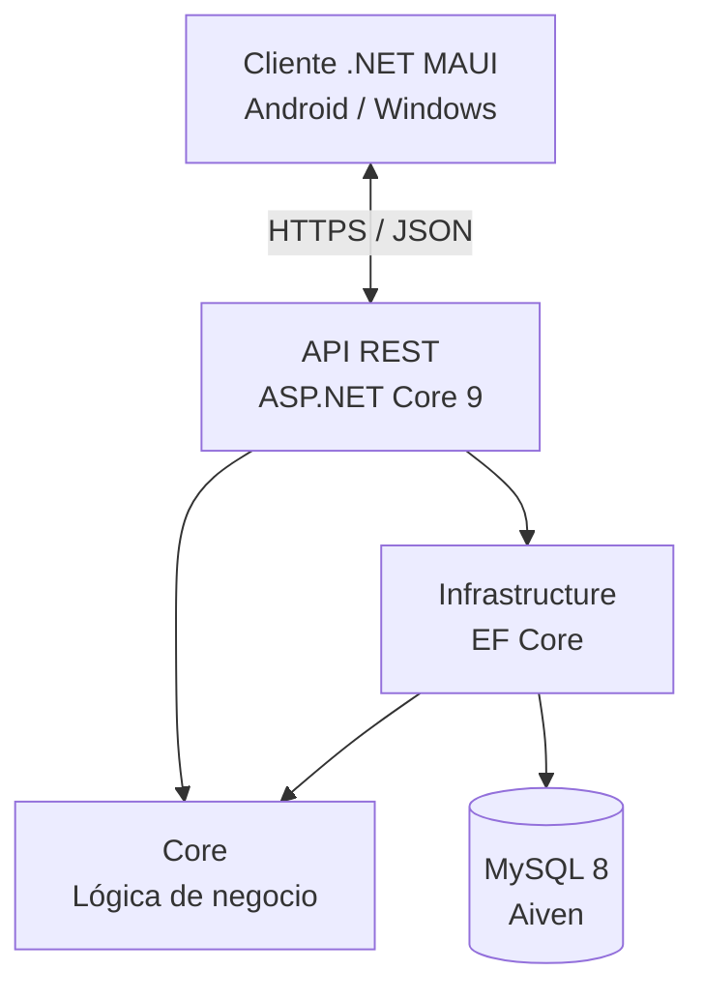

<div align="center">

# 💰 FinanzasApp

### Gestión de finanzas personales | Android & Windows

Aplicación multiplataforma para gestionar ingresos, gastos, objetivos financieros y grupos compartidos desde una única plataforma.

**Proyecto Final de Desarrollo de Aplicaciones Multiplataforma (DAM)**


**[📄 Consultar documentación técnica completa](docs/Documentación%20Finanzas%20App.pdf)**

</div>

---

## 📖 Sobre el proyecto

FinanzasApp nace con el objetivo de ofrecer una herramienta sencilla y completa para gestionar las finanzas personales, facilitando el seguimiento de ingresos, gastos y objetivos de ahorro sin necesidad de conocimientos de contabilidad.

La aplicación permite centralizar la información financiera, visualizar cómo se distribuye el dinero y colaborar con otras personas mediante grupos compartidos.

Está desarrollada con una arquitectura cliente-servidor, separando el backend en una API REST independiente y utilizando .NET MAUI para ofrecer una experiencia multiplataforma desde una única base de código.

---

## ✨ Funcionalidades principales

| Funcionalidad | Descripción |
|---|---|
| 💸 Ingresos y gastos | Registro y seguimiento de movimientos económicos |
| 🗂️ Categorías | Organización mediante categorías personalizadas |
| 📊 Estadísticas | Visualización de la distribución de gastos mediante gráficas |
| 🎯 Objetivos | Seguimiento automático del progreso financiero en tiempo real |
| 👥 Grupos | Gestión compartida de información financiera |
| 🏆 Ranking | Clasificación de gastos entre los miembros de un grupo |
| 🔐 Seguridad | Autenticación y autorización mediante JWT |

---

## 📱 Capturas de la aplicación

<div align="center">


</div>

---

## 🏗️ Arquitectura del proyecto

El proyecto sigue una arquitectura organizada en cuatro capas, aplicando principios de **Clean Architecture** y separación de responsabilidades.

Esta estructura permite mantener la lógica de negocio independiente de los detalles de infraestructura, facilitando el mantenimiento, las pruebas y la evolución del software.

### Organización por capas

| Capa | Responsabilidad |
|---|---|
| **Core** | Modelos de dominio, DTOs, interfaces de repositorio y enumeraciones |
| **Infrastructure** | Implementación de repositorios, acceso a datos con EF Core y mapeos con AutoMapper |
| **API** | Controladores REST, autenticación JWT y middleware de gestión de errores |
| **UI** | Cliente multiplataforma desarrollado en .NET MAUI siguiendo el patrón MVVM |

### Estructura general

```text
FinanzasApp
│
├── Core
│   ├── Models
│   ├── DTOs
│   ├── Interfaces
│   └── Enums
│
├── Infrastructure
│   ├── Repositories
│   ├── Data
│   └── Mappings
│
├── API
│   ├── Controllers
│   ├── Authentication
│   └── Middleware
│
└── UI (.NET MAUI)
    └── MVVM
```

*Esquema conceptual de las responsabilidades de cada capa.*

### Comunicación entre componentes



La interfaz se comunica con el backend mediante peticiones HTTP. La API gestiona la autenticación, las operaciones de negocio y la persistencia de los datos.

---

## 🛠️ Tecnologías utilizadas

### Backend

| Tecnología | Uso |
|---|---|
| .NET 9 | Plataforma de desarrollo |
| ASP.NET Core Web API | Construcción de endpoints REST |
| Entity Framework Core 9 | ORM para el acceso a datos |
| Pomelo.EntityFrameworkCore.MySQL 9.0.0 | Proveedor de MySQL para EF Core |
| MySQL 8 | Base de datos relacional |
| JWT | Autenticación y autorización |
| BCrypt | Hash seguro de contraseñas |
| AutoMapper | Mapeo entre entidades y DTOs |
| Swagger | Documentación y pruebas de la API |

### Frontend

| Tecnología | Uso |
|---|---|
| .NET MAUI 9 | Desarrollo multiplataforma para Android y Windows |
| CommunityToolkit.Mvvm | Implementación del patrón MVVM |
| CommunityToolkit.Maui | Controles y utilidades adicionales |
| Microcharts.Maui | Visualización de gráficas |
| SkiaSharp | Motor de renderizado 2D |

### Infraestructura y herramientas

<p>
  
</p>

- **Railway:** despliegue de la API.
- **Docker:** contenedorización del backend.
- **Aiven:** alojamiento de la base de datos MySQL.
- **Git y GitHub:** control de versiones.
- **Visual Studio 2022:** entorno de desarrollo.

---

## ☁️ Despliegue e infraestructura

FinanzasApp utiliza una infraestructura en la nube que permite mantener el backend y la base de datos independientes del cliente.

| Componente | Servicio |
|---|---|
| Aplicación cliente | .NET MAUI (Android / Windows) |
| Backend | Railway |
| Contenedor | Docker |
| Base de datos | Aiven (MySQL) |
| Comunicación | API REST mediante HTTPS |
| Autenticación | JWT |

La API se despliega mediante un contenedor Docker en Railway, mientras que MySQL se encuentra alojado en Aiven, utilizando conexiones cifradas mediante SSL.

Esta separación permite que los diferentes clientes accedan a los mismos datos centralizados, manteniendo la información sincronizada.

---

## 🔐 Seguridad

La aplicación incorpora mecanismos de seguridad tanto para la autenticación de usuarios como para la comunicación con los servicios externos.

- Autenticación basada en JSON Web Tokens (JWT).
- Almacenamiento de contraseñas mediante hash con BCrypt.
- Autorización de acceso a los recursos de la API.
- Conexión cifrada con la base de datos mediante SSL.
- Configuración de información sensible mediante variables de entorno.

---

## 🎓 Aprendizajes y retos técnicos

Durante el desarrollo de FinanzasApp pude aplicar conocimientos adquiridos durante el ciclo de DAM y enfrentarme a problemas propios de un entorno de desarrollo real.

Entre los principales aprendizajes destacan:

**1. Diseño de arquitecturas mantenibles**

Separación de responsabilidades en diferentes capas, evitando que los cambios en infraestructura afecten directamente a la lógica de negocio.

**2. Implementación de autenticación segura**

Integración de JWT para gestionar el acceso a la API y BCrypt para el almacenamiento seguro de contraseñas.

**3. Despliegue de una API en la nube**

Contenedorización mediante Docker y despliegue en Railway, resolviendo problemas relacionados con la asignación dinámica de puertos y la configuración de variables de entorno.

**4. Desarrollo multiplataforma**

Construcción de una interfaz compartida para Android y Windows mediante .NET MAUI y el patrón MVVM.

---

## 📚 Documentación

Para consultar información más detallada sobre el análisis, diseño, arquitectura e implementación del proyecto:

**[📄 Ver documentación técnica de FinanzasApp (PDF)](docs/Documentación%20Finanzas%20App.pdf)**

---

<div align="center">

### Desarrollado por Roberto Gómez Suárez

Proyecto Final del Ciclo Formativo de Grado Superior en Desarrollo de Aplicaciones Multiplataforma.

[](https://github.com/Roberto-GS)
[](https://www.linkedin.com/in/roberto-gómez-suárez-737aa0376/)

</div>
