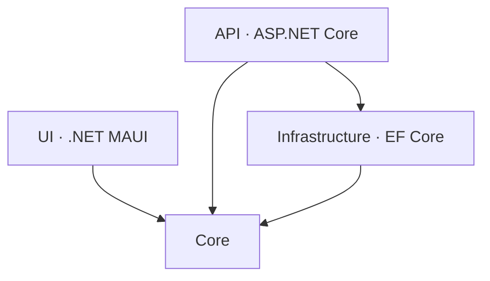
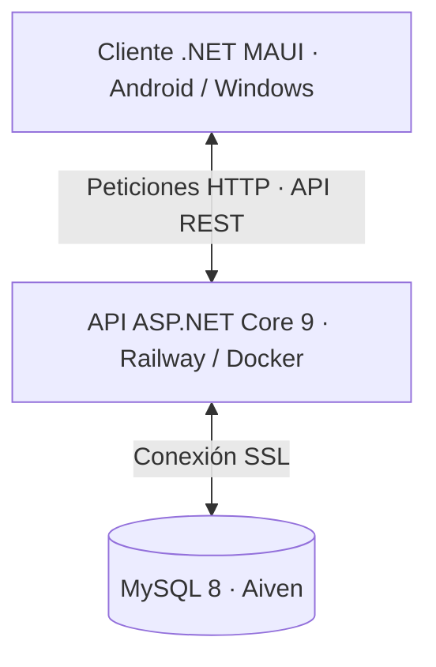

<div align="center">

# 💰 FinanzasApp

### Gestión de finanzas personales | Android y Windows

Aplicación multiplataforma para controlar ingresos, gastos, objetivos financieros y grupos compartidos desde una única plataforma.

**Proyecto Final de Desarrollo de Aplicaciones Multiplataforma (DAM) · Curso 2025/2026**


**[📄 Consultar documentación técnica completa](docs/Documentaci%C3%B3n%20Finanzas%20App.pdf)**

</div>

---

## 📖 Sobre el proyecto

FinanzasApp nace con el objetivo de ofrecer una herramienta sencilla y completa para gestionar las finanzas personales sin necesidad de conocimientos de contabilidad. Permite registrar y clasificar movimientos, consultar estadísticas, establecer objetivos con seguimiento automático y compartir un resumen financiero con otras personas mediante grupos.

La solución separa una **API REST con ASP.NET Core 9** del cliente **.NET MAUI 9**, compatible con Android y Windows desde una única base de código. Los datos se centralizan en MySQL, alojado en Aiven, y la API se despliega en Railway mediante Docker.

---

## ✨ Funcionalidades principales

| Funcionalidad | Descripción |
|---|---|
| 💸 Movimientos | Registro, edición, eliminación y búsqueda de ingresos y gastos |
| 🗂️ Categorías | Clasificación personalizada de movimientos mediante nombre y color |
| 📊 Estadísticas | Gráfica donut por categorías y gráfica de barras con evolución mensual |
| 🎯 Objetivos | Ahorro, límite de gasto, meta de ingreso y reducción de deuda, con progreso calculado en tiempo real |
| 👥 Grupos | Invitaciones, roles de administrador y miembro, y resumen financiero consolidado |
| 🏆 Ranking | Comparación mensual de gastos entre miembros del grupo |
| 🔔 Notificaciones | Avisos automáticos persistentes y dinámicos |
| 🔐 Acceso | Registro, inicio de sesión y protección de endpoints mediante JWT |

### 🔔 Notificaciones automáticas

El sistema no requiere configurar alertas manualmente:

- **Persistentes:** se almacenan cuando un objetivo se cumple o vence sin cumplirse.
- **Dinámicas:** se calculan en cada consulta, sin guardarse en la base de datos. Incluyen objetivos en peligro, vencimientos próximos con el tiempo restante y avisos cuando el gasto mensual supera en más de un 20 % el del mes anterior.

---

## 📱 Capturas de la aplicación

<div align="center">


</div>

---

## 🏗️ Arquitectura

La solución se organiza en **cuatro proyectos**, con responsabilidades y dependencias diferenciadas:

| Proyecto | Responsabilidad | Dependencias entre proyectos |
|---|---|---|
| **Core** | Modelos de dominio, DTOs, interfaces de repositorio y enumeraciones | Ninguna |
| **Infrastructure** | Persistencia con EF Core, repositorios y mapeos con AutoMapper | Core |
| **API** | Endpoints REST, autenticación JWT, servicios y middleware de errores | Core e Infrastructure |
| **UI** | Cliente .NET MAUI con patrón MVVM y servicios de comunicación | Core (DTOs compartidos) |

### Dependencias entre proyectos



### Comunicación y despliegue



La interfaz centraliza las llamadas HTTP en `ApiService`, que incorpora el token JWT en la cabecera `Authorization`. La API coordina la lógica de negocio y accede a la base de datos a través de los repositorios.

### Organización resumida

```text
FinanzasApp
├── Core
│   ├── DTOs
│   ├── Enums
│   ├── Interfaces
│   └── Models
├── Infrastructure
│   ├── Data
│   ├── Mappings
│   └── Repositories
├── API
│   ├── Controllers
│   ├── Extensions
│   ├── Middleware
│   ├── Services
│   └── Settings
└── UI
    ├── Converts
    ├── Extensions
    ├── Resources
    ├── Services
    ├── ViewModels
    └── Views
```

*Esquema resumido de las carpetas descritas en la documentación técnica.*

---

## 🛠️ Tecnologías utilizadas

### Backend

| Tecnología | Uso |
|---|---|
| .NET 9 / ASP.NET Core Web API | Desarrollo de la API REST |
| Entity Framework Core 9 | Acceso a datos mediante ORM |
| Pomelo.EntityFrameworkCore.MySQL 9.0.0 | Proveedor de MySQL para EF Core |
| MySQL 8 | Base de datos relacional |
| JWT | Autenticación y autorización |
| BCrypt | Hash de contraseñas |
| AutoMapper | Mapeo entre entidades y DTOs |
| Swagger / OpenAPI | Documentación y pruebas de la API |

### Cliente multiplataforma

| Tecnología | Uso |
|---|---|
| .NET MAUI 9 | Cliente Android y Windows |
| CommunityToolkit.Mvvm | Implementación del patrón MVVM |
| CommunityToolkit.Maui | Controles y utilidades adicionales |
| Microcharts.Maui | Gráficas donut y de barras |
| SkiaSharp | Renderizado 2D utilizado por Microcharts |

### Infraestructura y herramientas

<p>
  
</p>

- **Visual Studio 2022:** entorno de desarrollo.
- **GitHub:** repositorio y control de versiones.
- **Docker:** contenedorización de la API.
- **Railway:** despliegue del backend.
- **Aiven:** alojamiento de MySQL 8.

---

## ☁️ Despliegue

La API se despliega en Railway mediante un **Dockerfile multietapa**: una imagen con el SDK de .NET 9 compila y publica el proyecto, y otra imagen más ligera con el runtime ejecuta el resultado.

- Railway detecta los cambios enviados a GitHub y vuelve a desplegar la API automáticamente.
- La API lee el puerto dinámico asignado por Railway desde la variable de entorno `PORT`.
- La cadena de conexión y la clave secreta de JWT se configuran mediante variables de entorno, sin publicarlas en el repositorio.
- La conexión de la API con MySQL en Aiven utiliza SSL obligatorio.

---

## 🔐 Autenticación y seguridad

- Contraseñas almacenadas mediante hash con **BCrypt**, no en texto plano.
- Autenticación mediante tokens **JWT**.
- Endpoints protegidos con `[Authorize]`, excepto los de `AuthController`.
- Obtención del identificador del usuario desde los claims del token para gestionar el acceso a sus datos.
- Middleware global para convertir excepciones no controladas en respuestas JSON con códigos HTTP apropiados.
- Conexión cifrada entre API y base de datos mediante SSL.

---

## 🎓 Aprendizajes y retos técnicos

- **Arquitectura por capas:** separación de dominio, persistencia, API y cliente, con repositorios definidos mediante interfaces.
- **Seguridad de extremo a extremo:** registro e inicio de sesión con BCrypt y JWT, y protección de los recursos de la API.
- **Objetivos en tiempo real:** evaluación del progreso desde el servidor, cargando los movimientos del usuario una vez y filtrándolos por las fechas de cada objetivo para reducir consultas a la base de datos.
- **Notificaciones mixtas:** combinación de avisos persistentes y dinámicos, con control para evitar duplicados en peticiones simultáneas.
- **Despliegue real:** configuración de Docker, variables de entorno y puerto dinámico de Railway.
- **Desarrollo multiplataforma:** interfaz compartida Android/Windows mediante .NET MAUI y MVVM.

---

## 📚 Documentación técnica

La memoria completa incluye análisis, tecnologías, arquitectura, modelo de datos, manual de usuario, pruebas, autenticación, seguridad y despliegue.

**[📄 Ver documentación completa de FinanzasApp (PDF)](docs/Documentaci%C3%B3n%20Finanzas%20App.pdf)**

---

<div align="center">

**Desarrollado por Roberto Gómez Suárez**

Proyecto Final de DAM · IES Luis Carrillo de Sotomayor · 2025/2026

[](https://github.com/Roberto-GS)
[](https://www.linkedin.com/in/roberto-g%C3%B3mez-su%C3%A1rez-737aa0376/)

</div>
